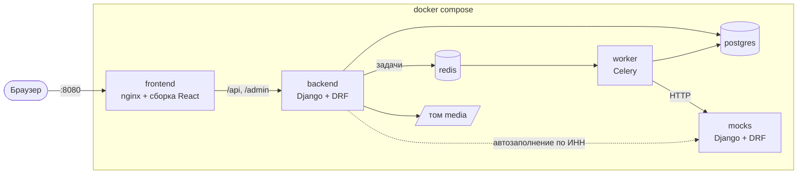

# SME Credit — умный кредитный кабинет предпринимателя

Прототип сквозного кредитного процесса для малого бизнеса. Решение для кейса «Умный кредитный кабинет предпринимателя» хакатона Альфа-Хак.

Предприниматель выбирает продукт, подаёт заявку и следит за её статусом в веб-кабинете. Банк внутри той же системы проверяет заявку, подтягивает данные из внешних источников, оценивает риск и выносит решение. Итог не бинарный: одобрение, контрпредложение, дозапрос информации или отказ. Спорные заявки разбирает андеррайтер в своём кабинете. Подписание и выдача симулируются.

## Демо-стенд

Развёрнутая версия: **https://sme-credit.ru** (зеркало — https://sme-credit.online). Ставить ничего не нужно: откройте ссылку и войдите по любой карточке на странице входа. Учётки те же, что в разделе [Тестовые учётки](#тестовые-учётки), сценарий проверки — в разделе [Как пройти сценарий](#как-пройти-сценарий).

Стенд общий для всех проверяющих: кто-то мог уже привязать компанию к учётке или подать заявки. Для прогона с чистыми данными запустите проект локально, как описано ниже.

## Быстрый старт

Нужен только Docker с Docker Compose.

```bash
cp .env.example .env
docker compose up --build
```

После запуска:

| Что | Адрес |
|---|---|
| Кабинет клиента и андеррайтера | http://localhost:8080 |
| Документация API (Swagger UI) | http://localhost:8080/api/v1/docs/ |
| Админка (справочники и параметры модели) | http://localhost:8080/admin/ |
| Проверка, что всё живо | http://localhost:8080/api/v1/health |
| Контракты моков | http://localhost:8090/docs/ |

Всё, кроме моков, открывается через один адрес `localhost:8080`: nginx проксирует `/api` и `/admin` на бэкенд. Бэкенд дополнительно доступен напрямую на `localhost:8000` — это удобно для отладки, для проверки не нужно.

Тестовые учётки показаны прямо на странице входа: нажмите на любую, чтобы войти.

В Docker поднимаются контейнеры `postgres`, `redis`, `mocks`, `backend` (API и админка), `worker` (Celery: проверка заявки и выдача) и `frontend` (nginx раздаёт собранный React и проксирует `/api` и `/admin` на бэкенд).

Миграции и демо-данные загружаются автоматически при первом запуске.

## Требования к окружению

- Docker Engine 24+ с Docker Compose v2 (команда `docker compose`) или Docker Desktop на Windows и macOS. Больше ничего ставить не нужно: Python, Node.js и база живут внутри контейнеров.
- Свободные порты 8080, 8000 и 8090. Если какой-то занят, поменяйте `FRONTEND_PORT`, `BACKEND_PORT` или `MOCKS_PORT` в `.env`.
- Доступ в интернет при первой сборке: Docker скачивает образы, а сборка ставит зависимости из lock-файлов. Сами приложения во внешние сервисы не ходят.
- Ориентировочно 4 ГБ оперативной памяти для Docker и 3 ГБ на диске. Первая сборка занимает несколько минут, следующие запуски — секунды.

Версии зафиксированы: Python 3.12 и Node.js 24 — в Dockerfile, библиотеки — в `backend/uv.lock`, `mocks/uv.lock` и `frontend/package-lock.json`, образы PostgreSQL 16, Redis 7.2 и nginx 1.28 — в `docker-compose.yml` и Dockerfile фронтенда.

## Архитектура



Клиент нажимает «Отправить заявку», бэкенд переводит её в статус «На проверке» и ставит задачу в очередь. Worker опрашивает внешние источники (моки ЕГРЮЛ/ЕГРИП, «Прозрачного бизнеса» и БКИ), прогоняет модель решения и записывает итог. Фронтенд раз в 4 секунды опрашивает статус, поэтому кабинет обновляется сам. Подробности, модель данных и описание API — в [docs/04-architecture.md](docs/04-architecture.md).

### Компоненты

| Контейнер | Что делает | Наружу |
|---|---|---|
| `frontend` | nginx отдаёт собранный React (кабинет клиента и андеррайтера) и проксирует `/api` и `/admin` на бэкенд. Фронт и API на одном адресе, поэтому CORS не нужен | `localhost:8080` |
| `backend` | REST API на Django + DRF, админка, вход по JWT, машина состояний заявки. При старте применяет миграции и загружает демо-данные | `localhost:8000`, для отладки: Swagger, админка, healthcheck |
| `worker` | Тот же образ, что у бэкенда, но запускает Celery: конвейер проверки заявки и симуляция выдачи | нет |
| `mocks` | Моки внешних сервисов: ЕГРЮЛ/ЕГРИП, «Прозрачный бизнес», БКИ. Синтетические компании лежат в JSON, доступ по ключу `X-Api-Key` | `localhost:8090/docs/` — контракты |
| `postgres` | Основная база: заявки, журнал событий, решения, ответы источников | нет |
| `redis` | Брокер задач Celery | нет |

Внутри бэкенда код разбит на Django-приложения: `accounts` (пользователи, компании, вход), `catalog` (продукты, документы, параметры модели), `applications` (заявки, документы, дозапросы, журнал, конвейер), `integrations` (HTTP-клиенты к источникам с таймаутами и повторами), `decisioning` (стоп-факторы, скоринг, кредитная логика — чистые функции без базы) и `underwriting` (очередь и решения андеррайтера).

## Тестовые учётки

Пароль у всех учёток: `x123x`. На странице входа учётки показаны карточками — достаточно нажать на нужную.

Каждый клиент при первом входе привязывает свою компанию по ИНН: на шаге привязки есть кнопка «Подставить и найти», которая подставит тестовый ИНН этой учётки. Привязка необратима, поэтому используйте ИНН из таблицы. Все компании и ИНН синтетические.

| Логин | Компания | ИНН | Чем закончится заявка | Почему |
|---|---|---|---|---|
| `Reliable` | ООО «Надёжная пекарня» | `9901000010` | Одобрение | Больше 3 лет, без долгов и просрочек, нагрузка низкая |
| `Ambitious` | ИП Дуров П. А. | `990100000285` | Контрпредложение | Чистая история, но просит много относительно выручки |
| `Inaccurate` | ООО «Неточная отделка» | `9901000034` | Дозапрос | Выручка в анкете расходится с отчётностью больше чем на 30% |
| `Borderline` | ИП Светлов Н. О. | `990100000422` | Андеррайтер | Истории нет, налоговый долг больше 10% месячной выручки, класс риска C |
| `Problematic` | ООО «Проблемная логистика» | `9901000059` | Отказ | Компания ликвидируется, есть текущая просрочка |
| `Capricious` | ООО «Капризная мастерская» | `9901000066` | Андеррайтер | БКИ не отвечает, после повторов заявка уходит человеку |

Сотрудники банка:

| Логин | Роль | Где работает |
|---|---|---|
| `underWriter` | Андеррайтер | Кабинет андеррайтера: http://localhost:8080 |
| `admin` | Администратор | Админка: http://localhost:8080/admin/ — продукты, требования к документам, параметры модели решения |

Чтобы начать с чистой базы (например, если компанию привязали не к той учётке), остановите контейнеры с удалением томов и запустите заново:

```bash
docker compose down -v
docker compose up --build
```

## Как пройти сценарий

Для загрузки документов подойдёт любой файл PDF, JPG или PNG до 10 МБ: содержимое не проверяется, только формат. Список документов зависит от формы бизнеса и налогового режима и показывается в анкете сам.

### Основной путь: от заявки до выдачи

1. Откройте http://localhost:8080 и нажмите на карточку `Reliable`.
2. Кабинет попросит указать компанию. Нажмите «Подставить и найти»: название, адрес, руководитель и налоговый режим подтянутся из ЕГРЮЛ и ФНС. Проверьте их и привяжите компанию.
3. Откройте «Новая». В каталоге видны условия каждого продукта и список документов под вашу компанию. У «Экспресс-кредита» нажмите «Оформить заявку».
4. Заполните анкету-мастер:
   - «Сумма и срок»: 1 500 000 ₽, 24 месяца, цель — любая;
   - «Финансы»: выручка 60 000 000 ₽, платежи по другим кредитам 0;
   - «Документы»: загрузите файл на каждый пункт списка;
   - «Проверка»: отметьте согласие на запрос кредитной истории и нажмите «Отправить заявку».

   Анкета сохраняется сама. Можно закрыть вкладку посреди заполнения: черновик откроется на том же шаге.
5. Заявка получает статус «На проверке». Через несколько секунд страница сама обновится на «Одобрено»: в таймлайне видно, что система собрала данные из источников и рассчитала оценку риска.
6. Нажмите «Принять предложение», затем на шаге подписания отметьте согласие и нажмите «Подписать договор».
7. Статус станет «Выдача», а примерно через 5 секунд — «Выдано», с номером договора и условиями кредита.

### Другие исходы

Анкету заполняйте так же, как в основном пути, меняя только продукт и цифры.

| Учётка | Продукт и данные анкеты | Что произойдёт и что проверить |
|---|---|---|
| `Ambitious` | Экспресс-кредит, 3 000 000 ₽ на 24 месяца, выручка 4 800 000 ₽, платежи 0 | Контрпредложение на 2 400 000 ₽: кредит ограничен долей годовой выручки. Кабинет сравнивает «просили / предлагаем». Нажмите «Отказаться» — заявка перейдёт в «Отменена» с причиной «Вы отказались от предложения банка» |
| `Inaccurate` | Кредит на оборотные средства, 2 000 000 ₽ на 24 месяца, выручка 18 000 000 ₽, платежи 90 000 ₽ | Дозапрос: по отчётности выручка около 11,8 млн ₽. Ответьте банку и исправьте выручку на 12 000 000 ₽ — заявка вернётся на проверку и будет одобрена. Если дважды ответить без исправления, заявка уйдёт андеррайтеру, а не на третий круг |
| `Borderline` | Экспресс-кредит, 1 000 000 ₽ на 24 месяца, выручка 9 000 000 ₽, платежи 0 | Заявка уходит к андеррайтеру. Выйдите и войдите как `underWriter`: заявка в очереди с причинами «Класс риска C» и «Налоговый долг больше 10% месячной выручки». В карточке — анкета, ответы источников и раскладка баллов. Нажмите «Взять в работу» и выберите исход: без комментария решение не отправится. Если выбрать дозапрос, после ответа клиента заявка вернётся к андеррайтеру |
| `Problematic` | Любой продукт и данные | Уже на шаге привязки компании кабинет предупредит, что кредит не одобрят. Если всё же подать заявку — отказ с причиной простым языком. После отказа можно подать новую заявку, старая останется в истории |
| `Capricious` | Любой продукт, например Экспресс-кредит на 1 000 000 ₽, выручка 15 500 000 ₽ | БКИ отвечает ошибкой. Система делает несколько повторов и через несколько секунд передаёт заявку андеррайтеру с причиной «Внешний источник не ответил», а не оставляет её висеть |

### Что ещё можно проверить

- Отмена: заявку можно отменить на любом шаге до подписания. После подписания кнопки отмены нет.
- Одна активная заявка на продукт: черновиков может быть сколько угодно, но вторую заявку на тот же продукт не отправить, пока первая в работе.
- Права доступа: ссылка на чужую заявку открывает «Заявка не найдена», а клиент не попадает в кабинет андеррайтера.
- Админка: под `admin` видны продукты, требования к документам и параметры модели решения. Новую версию параметров можно создать кнопкой «Сохранить как новый объект». Журнал событий и решения в админке доступны только для просмотра.
- API: в Swagger UI нажмите Authorize и вставьте access-токен из ответа `POST /api/v1/auth/login`. Тот же набор запросов есть в коллекции Bruno: `docs/api/collection`.

## Переменные окружения

Все настройки лежат в `.env`, образец — `.env.example`. Значения по умолчанию рассчитаны на локальный запуск с синтетическими данными, менять их для проверки не нужно. После правки `.env` перезапустите контейнеры: `docker compose up -d`.

| Переменная | По умолчанию | Что задаёт |
|---|---|---|
| `FRONTEND_PORT` | `8080` | Порт кабинета на вашей машине |
| `BACKEND_PORT` | `8000` | Порт бэкенда на вашей машине: Swagger, админка, healthcheck |
| `MOCKS_PORT` | `8090` | Порт моков на вашей машине: просмотр контрактов |
| `POSTGRES_DB`, `POSTGRES_USER`, `POSTGRES_PASSWORD` | `sme_credit`, `sme_credit`, `sme_credit_local` | База PostgreSQL в Docker. Без Docker бэкенд работает на SQLite |
| `CELERY_TASK_ALWAYS_EAGER` | `1` | Только для запуска без Docker: задачи выполняются сразу, без Redis. В Docker docker-compose ставит `0` |
| `DISBURSEMENT_DELAY_SECONDS` | `5` | Через сколько секунд после подписания «зачисляются» деньги |
| `DJANGO_SECRET_KEY` | тестовый ключ | Подпись токенов и сессий. Для публичного стенда замените |
| `DJANGO_DEBUG` | `0` | Режим отладки Django |
| `DJANGO_ALLOWED_HOSTS` | `localhost,127.0.0.1,backend` | С каких адресов бэкенд принимает запросы. При публикации добавьте домен |
| `DJANGO_CSRF_TRUSTED_ORIGINS` | адреса `localhost` и `127.0.0.1` на портах 8080 и 8000 | Откуда можно войти в админку. При смене `FRONTEND_PORT` или домена поправьте и здесь |
| `JWT_ACCESS_LIFETIME_MINUTES` | `15` | Сколько живёт access-токен |
| `JWT_REFRESH_LIFETIME_DAYS` | `1` | Сколько живёт refresh-токен в cookie |
| `AUTH_COOKIE_SECURE` | `0` | `1` — refresh-cookie уходит только по HTTPS. Включите при публикации за HTTPS |
| `MOCKS_BASE_URL` | `http://localhost:8090` | Только для запуска без Docker: адрес моков. В Docker docker-compose подставляет `http://mocks:8090` |
| `MOCKS_TIMEOUT_SECONDS` | `3` | Таймаут одного запроса к внешнему источнику |
| `MOCKS_MAX_RETRIES` | `3` | Сколько попыток сделать, прежде чем считать источник недоступным |
| `MOCKS_API_KEY` | `mocks-local-key` | Ключ, который бэкенд передаёт мокам в заголовке `X-Api-Key` |
| `MOCKS_BKI_DELAY_SECONDS` | `5` | Сколько «думает» БКИ у компании со сбоем `timeout` (см. [mocks/README.md](mocks/README.md)) |
| `SEED_DEMO_DATA` | `1` | Загружать ли при старте тестовые учётки, продукты и требования к документам. Повторная загрузка ничего не перезаписывает |

Необязательные переменные, которых нет в `.env.example`: `LOG_LEVEL` (уровень логов, по умолчанию `INFO`), `GUNICORN_WORKERS` (число процессов бэкенда, `3`), `CELERY_CONCURRENCY` (число параллельных задач worker'а, `2`), `MOCKS_ALLOWED_HOSTS` и `MOCKS_DATA_FILE` (адреса и файл данных моков).

## Документация

| Документ | О чём |
|---|---|
| [docs/01-research.md](docs/01-research.md) | Персоны, путь клиента, боли, матрица «боль → функция» и приоритеты |
| [docs/02-process.md](docs/02-process.md) | Процесс, участники, статусы заявки и переходы, данные, тестовые компании |
| [docs/03-decision-model.md](docs/03-decision-model.md) | Стоп-факторы, скоринг, обоснование порогов, кредитная логика |
| [docs/04-architecture.md](docs/04-architecture.md) | Стек, контейнеры, структура репозитория, модель данных, API, упрощения |
| [mocks/README.md](mocks/README.md) | Моки внешних сервисов, синтетические компании и как изобразить сбой источника |
| [frontend/README.md](frontend/README.md), [frontend/DESIGN.md](frontend/DESIGN.md) | Устройство фронтенда, команды, дизайн-токены и правила интерфейса |

Артефакты, которые требует кейс:

| Что | Где |
|---|---|
| Архитектурная схема | [Архитектура](#архитектура) выше и [docs/04-architecture.md](docs/04-architecture.md#контейнеры), там же диаграмма последовательности конвейера |
| Описание API | [docs/04-architecture.md](docs/04-architecture.md#api) |
| OpenAPI | [docs/api/openapi.yaml](docs/api/openapi.yaml), живая схема — http://localhost:8080/api/v1/schema/, Swagger UI — http://localhost:8080/api/v1/docs/ |
| Коллекция запросов | [docs/api/collection](docs/api/collection) (Bruno). Откройте папку в Bruno, выберите окружение `local` и выполните `auth/auth_login_create`: токен сохранится в окружение сам, а `applications_create` так же запомнит id заявки |
| Диаграмма состояний заявки | [docs/02-process.md](docs/02-process.md#статусы-заявки) |
| Модель данных | [docs/04-architecture.md](docs/04-architecture.md#модель-данных) |
| Тестовые сценарии | [Как пройти сценарий](#как-пройти-сценарий) выше и автотесты (см. [Тесты](#тесты)) |

## Тесты

Тесты запускаются без Docker. Нужны [uv](https://docs.astral.sh/uv/) (он сам поставит Python 3.12) и Node.js 24. Бэкенд читает настройки из `.env` в корне, поэтому сначала выполните `cp .env.example .env`, если ещё не сделали.

```bash
# Бэкенд: API, машина состояний, конвейер, модель решения, эталонные профили из docs/03-decision-model.md
cd backend && uv sync && uv run pytest

# Моки: контракты и синтетические данные
cd mocks && uv sync && uv run pytest

# Фронтенд: компонентные тесты, типы, линтер
cd frontend && npm ci && npm test && npm run typecheck && npm run lint
```

Три теста бэкенда в `tests/test_integrations.py` ходят в настоящие моки и пропускаются, если моки не запущены. Чтобы их включить, поднимите моки (`docker compose up mocks` или `uv run python manage.py runserver 8090` в папке `mocks`).

E2E-сценарии Playwright идут против настоящего бэкенда на `localhost:8000` с демо-данными и запущенными моками, например поднятых через `docker compose up`. Подробнее — в [frontend/README.md](frontend/README.md):

```bash
cd frontend
npx playwright install chromium   # один раз
npm run e2e
```

## Стек

Django + Django REST Framework, PostgreSQL, Celery + Redis, отдельный сервис на Django + DRF для моков внешних сервисов, React + TypeScript на фронтенде. Подробности и обоснование в [docs/04-architecture.md](docs/04-architecture.md), лицензии сторонних компонентов в [THIRD_PARTY_NOTICES.md](THIRD_PARTY_NOTICES.md).

## Ограничения

- Все данные синтетические. Внешние сервисы (ЕГРЮЛ/ЕГРИП, «Прозрачный бизнес», БКИ) заменены моками.
- Подписание и выдача кредита симулируются.
- Полный список упрощений и того, как это было бы устроено в банке, — в [docs/04-architecture.md](docs/04-architecture.md#упрощения).
