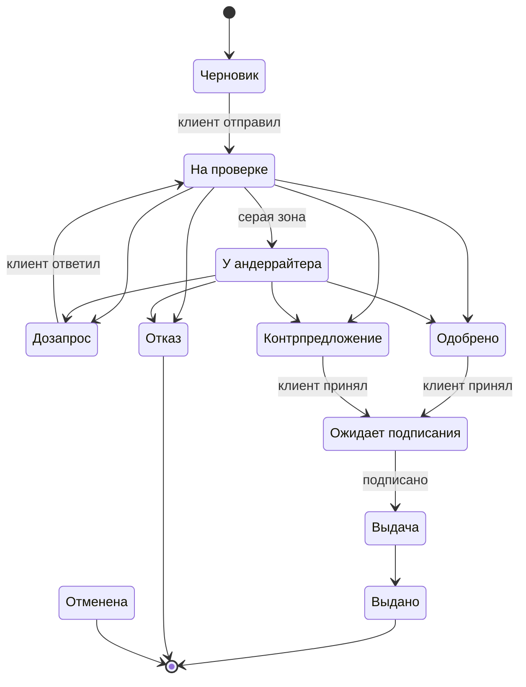

# Модель процесса

Как заявка проходит от выбора продукта до выдачи денег: кто в этом участвует, через какие статусы она идёт и какие данные нужны на каждом шаге. Почему процесс устроен именно так, объясняет [01-research.md](01-research.md). Правила, по которым выбирается исход, описаны в [03-decision-model.md](03-decision-model.md).

## Границы

Процесс начинается, когда клиент вошёл в кабинет и выбирает продукт. Регистрация и выбор банка в него не входят, для входа есть тестовые учётки.

Заканчивается он в одном из трёх случаев: деньги «зачислены» (симуляция), заявка отклонена или клиент её отменил.

## Участники

| Участник | Что делает |
|---|---|
| Клиент | Работает через веб-кабинет: заполняет заявку, отвечает на дозапросы, принимает или отклоняет предложение, подписывает |
| Система | Автоматическая часть конвейера: проверки, обогащение, скоринг, правила решения |
| Андеррайтер | Сотрудник банка, разбирает заявки, которые система не решила сама |
| Внешние сервисы (моки) | ЕГРЮЛ/ЕГРИП, «Прозрачный бизнес», БКИ. Сами ничего не решают, только отдают данные по запросу системы |

## Этапы

| # | Этап | Кто | Что происходит |
|---|---|---|---|
| 1 | Заполнение | Клиент | Выбирает продукт и вводит ИНН, данные компании подтягиваются из реестра. Заполняет анкету, прикладывает документы. Всё сохраняется как черновик |
| 2 | Подача | Клиент, система | Клиент отправляет заявку, система проверяет, что всё заполнено и корректно |
| 3 | Проверки и обогащение | Система, моки | Запросы в реестры и БКИ. Если сработал стоп-фактор, сразу отказ |
| 4 | Скоринг | Система | Балл и класс риска по анкете и внешним данным |
| 5 | Решение | Система или андеррайтер | Правила по классу, продукту и сумме выбирают исход. Спорные заявки уходят андеррайтеру |
| 6 | Дозапрос | Клиент | Если данных не хватает, клиент отвечает в кабинете, и заявка возвращается на этап 3 |
| 7 | Ответ на предложение | Клиент | Принимает одобрение или контрпредложение либо отказывается |
| 8 | Подписание | Клиент | Смотрит сводку условий и подписывает в интерфейсе (симуляция) |
| 9 | Выдача | Система | «Зачисляет» деньги (симуляция) |

## Статусы заявки

Этапы описывают, что происходит с заявкой, а статус показывает, где она находится прямо сейчас. Этапы 3–5 для клиента выглядят как один статус «На проверке». Обогащение и скоринг — внутренние шаги, они пишутся в журнал событий. На таймлайне их можно показать как прогресс внутри статуса.

Отмена в схеме не нарисована, чтобы не загромождать её стрелками. Клиент может отменить заявку из любого статуса до подписания, то есть до перехода в `DISBURSING`.

### Переходы

| Из | В | Кто запускает | Условие |
|---|---|---|---|
| `DRAFT` | `IN_REVIEW` | Клиент | Все обязательные поля и документы на месте |
| `IN_REVIEW` | `REJECTED` | Система | Стоп-фактор, класс D или допустимая сумма меньше минимума продукта |
| `IN_REVIEW` | `INFO_REQUESTED` | Система | Данные расходятся с источниками или не хватает документа |
| `IN_REVIEW` | `UNDERWRITING` | Система | Класс C, сумма выше порога автоматического решения, тревожный флаг, два раунда дозапроса без результата |
| `IN_REVIEW` | `APPROVED` | Система | Класс A или B, запрос не больше допустимой суммы |
| `IN_REVIEW` | `COUNTER_OFFER` | Система | Класс A или B, запрос больше допустимой суммы, но она не меньше минимума продукта |
| `UNDERWRITING` | любой из четырёх исходов | Андеррайтер | Решение с обязательным комментарием |
| `INFO_REQUESTED` | `IN_REVIEW` | Клиент | Клиент ответил. Если дозапрос делал андеррайтер, заявка возвращается к нему в `UNDERWRITING` |
| `APPROVED`, `COUNTER_OFFER` | `AWAITING_SIGNATURE` | Клиент | Принял предложение |
| `APPROVED`, `COUNTER_OFFER` | `CANCELLED` | Клиент | Отказался от предложения |
| `AWAITING_SIGNATURE` | `DISBURSING` | Клиент | Подписал |
| `DISBURSING` | `DISBURSED` | Система | Симуляция зачисления завершена |
| любой статус до `DISBURSING` | `CANCELLED` | Клиент | Отменил заявку |

Финальные статусы: `DISBURSED`, `REJECTED`, `CANCELLED`. Из них никуда не переходят. Отказ клиента от предложения и обычная отмена ведут в один статус, а различаются причиной в журнале.

В интерфейсе статусы делятся на две группы. В `DRAFT`, `INFO_REQUESTED`, `APPROVED`, `COUNTER_OFFER` и `AWAITING_SIGNATURE` ход за клиентом, и кабинет должен прямо сказать, что ему сделать. В остальных заявка у банка, и клиенту достаточно видеть, что она движется.

## Данные

Клиента спрашиваем только о том, что не можем узнать сами. Каждое поле, которое подтянулось из реестра, снимает одну из болей карты пути.

### Заполнение

| Данные | Откуда | Зачем |
|---|---|---|
| Продукт | Выбирает клиент | Определяет лимиты, список документов и правила |
| Сумма, срок, цель | Клиент | Основа заявки и будущего оффера |
| ИНН | Клиент | Ключ для всех внешних запросов |
| Название, форма (ИП/ООО), ОГРН, адрес, руководитель, ОКВЭД, дата регистрации | Мок ЕГРЮЛ/ЕГРИП, клиент проверяет | Чтобы не вводить вручную |
| Налоговый режим | Мок «Прозрачного бизнеса» или выбор клиента | От него зависит список документов |
| Выручка за год, платежи по другим кредитам | Клиент | Скоринг, потом сверка с источниками |
| Залог: вид и стоимость | Клиент, только для инвестиционного кредита | Лимит и условия |
| Заявитель: ФИО, должность | Профиль пользователя | Кто подаёт и кто подписывает |
| Документы | Клиент загружает по списку | Подтверждение цифр |
| Согласие на запрос кредитной истории и обработку данных | Клиент | Без согласия банк не вправе запрашивать кредитную историю |

### Проверки и обогащение

| Данные | Откуда | Зачем |
|---|---|---|
| Статус компании: действует или ликвидируется | ЕГРЮЛ/ЕГРИП | Стоп-фактор |
| Дисквалификация руководителя, массовый адрес | «Прозрачный бизнес» | Стоп-фактор и тревожный флаг |
| Налоговая задолженность и её сумма | «Прозрачный бизнес» | Скоринг и правило для крупного долга |
| Доходы и расходы по отчётности (для ООО) | «Прозрачный бизнес» | Сверка с выручкой из анкеты |
| Текущие кредиты, платежи, просрочки | БКИ | Долговая нагрузка и платёжная дисциплина |

У ИП кредитная история — это история самого человека как физлица. У ООО запрашивается история компании.

### Скоринг и решение

Система считает сама:

- производные показатели: возраст бизнеса, долговая нагрузка, размер запроса относительно выручки, расхождение заявленной выручки с источниками;
- результат скоринга: балл, класс риска и вклад каждого фактора;
- решение: исход, кто его принял (система или андеррайтер), коды причин, условия оффера (сумма, срок, ставка, платёж);
- дозапрос: что спросили и что ответил клиент.

### Подписание и выдача

- отметка о подписании: кто и когда;
- номер договора (генерируется), сумма и дата «зачисления».

### Журнал событий

Это не технический лог. Технический лог нужен разработчикам, его можно чистить и ротировать. Журнал событий — бизнес-данные заявки в базе. Каждая запись хранит время, автора (клиент, система или конкретный андеррайтер), действие, переход статуса и причину. Записи не удаляются и не редактируются. Клиент видит журнал как таймлайн, андеррайтер — как полную историю заявки.

### Снимок данных на момент решения

После дозапроса анкета меняется, а решение должно ссылаться на те данные, по которым его принимали. Поэтому при каждом решении сохраняется снимок входных данных и результата скоринга. Это нужно при любом разборе спорной ситуации.

### Справочники

Это настройки системы, а не данные конкретной заявки:

- каталог продуктов: минимальная и максимальная сумма и срок, базовая ставка, нужен ли залог, минимальный возраст бизнеса, список документов в зависимости от формы бизнеса и налогового режима;
- правила: стоп-факторы, веса скоринга, пороги классов и исходов. Значения описаны в [03-decision-model.md](03-decision-model.md).

## Тестовые компании

Чтобы жюри могло пройти все ветки процесса, в моках заводятся синтетические компании с выдуманными ИНН. Каждая ведёт в свой исход:

| Компания | Что в данных | Ожидаемый исход |
|---|---|---|
| «Надёжная» | Давно работает, без долгов и просрочек | Одобрение |
| «Амбициозная» | Просит много относительно выручки | Контрпредложение |
| «Неточная» | Выручка в анкете сильно расходится с отчётностью | Дозапрос |
| «Пограничная» | Средний балл или крупная сумма | Андеррайтер |
| «Проблемная» | Ликвидируется или есть текущая просрочка | Отказ |
| «Капризная» | Данные хорошие, но БКИ не отвечает | Андеррайтер с причиной `SOURCE_UNAVAILABLE` |

Реальные компании не используются, в кейсе это запрещено. ИНН и подробности по данным — в [mocks/README.md](../mocks/README.md).

## Принятые решения

- После отказа клиент может подать новую заявку. Старая остаётся в истории.
- Одна компания может держать только одну активную заявку на каждый продукт. Черновиков может быть сколько угодно.
- Срок жизни оффера (например, 5 дней, после чего заявка отменяется с причиной «истёк срок») отложен в Could: для него нужен планировщик задач, а сквозной путь работает и без этого.
- Вход только по тестовым учёткам клиентов и андеррайтера, без регистрации.
