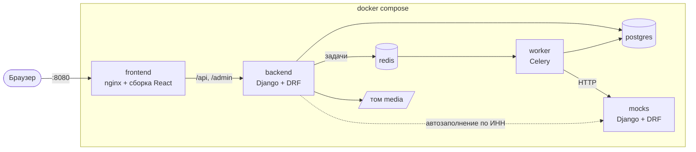
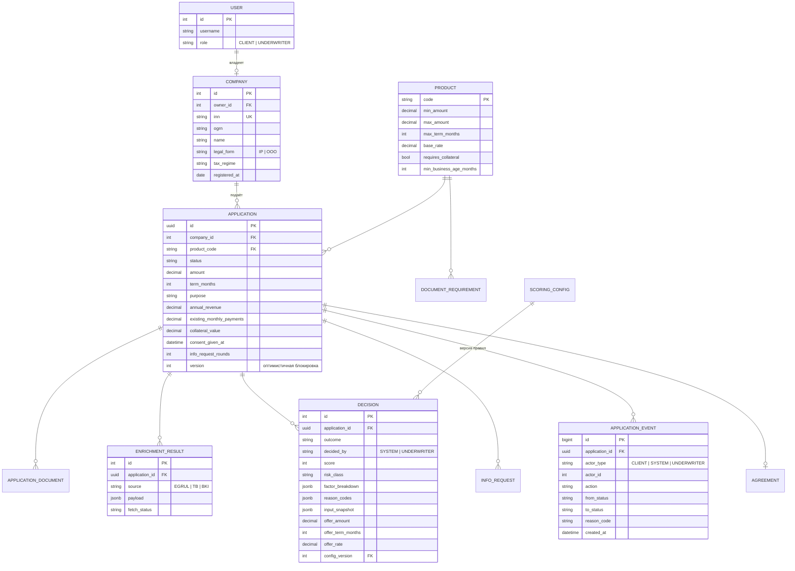
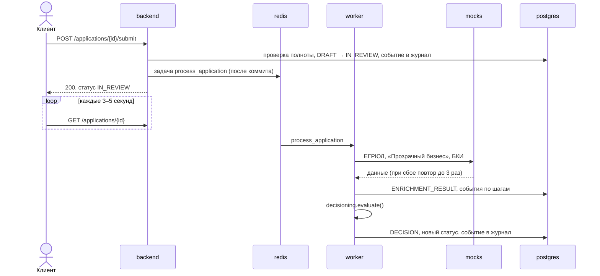

# Архитектура

Из каких частей состоит система, как они связаны и где что лежит в репозитории. Процесс и статусы описаны в [02-process.md](02-process.md), правила решения в [03-decision-model.md](03-decision-model.md).

## Стек

| Часть | Что берём | Почему |
|---|---|---|
| Бэкенд | Python 3.12, Django 5, Django REST Framework | Админка, миграции, загрузка файлов и JWT есть готовыми. Python знает вся команда |
| OpenAPI | drf-spectacular | Схема генерируется из кода и не расходится с API |
| Авторизация | djangorestframework-simplejwt | Access- и refresh-токены |
| База | PostgreSQL 16 | Транзакции, `JSONB` для сырых ответов внешних сервисов и снимков решений |
| Фоновые задачи | Celery + Redis | Конвейер не блокирует запрос клиента, а сбой внешнего сервиса ведёт к повтору, а не к ошибке |
| Моки | Django + DRF, drf-spectacular | Отдельный маленький сервис со своей OpenAPI-схемой. Тот же стек, что у бэкенда, поэтому второй фреймворк учить не нужно. Базы у него нет, данные лежат в JSON |
| Фронтенд | React 19, TypeScript, Vite, React Router 7, TanStack Query 5, react-hook-form + zod 4 | TanStack Query закрывает опрос статуса, zod — проверку полей анкеты |
| UI-библиотека | Mantine 9, иконки Tabler, шрифт Manrope | Формы, загрузка файлов, таймлайн, таблицы и уведомления есть из коробки. Светлая и тёмная тема без своей дизайн-системы. Токены в [frontend/DESIGN.md](../frontend/DESIGN.md) |
| Клиент API на фронте | orval | Типы и функции запросов генерируются из OpenAPI бэкенда |
| Зависимости | uv (`uv.lock`), npm (`package-lock.json`), версии языков в `.python-version` и `frontend/.nvmrc` | Кейс требует lock-файлы и фиксированные версии |
| Качество | pytest, pytest-django, eslint, prettier, Vitest + Testing Library + MSW, Playwright | Фронт: компонентные тесты против замоканного HTTP, E2E против настоящего бэкенда |
| Запуск | Docker Compose | Жюри поднимает всё одной командой |

Ни один компонент не требует платных подписок или внешних API.

## Контейнеры



| Контейнер | Что делает | Наружу |
|---|---|---|
| `frontend` | nginx отдаёт собранный React и проксирует `/api` и `/admin` на бэкенд. Фронт и API живут на одном адресе, поэтому CORS не нужен | `localhost:8080` |
| `backend` | REST API, админка, авторизация. При старте применяет миграции и загружает демо-данные | нет |
| `worker` | Тот же образ, что у бэкенда, но запускает Celery. Выполняет конвейер и симуляцию выдачи | нет |
| `mocks` | ЕГРЮЛ/ЕГРИП, «Прозрачный бизнес», БКИ. Данные из JSON-файла, ключ — ИНН. Доступ по ключу в заголовке `X-Api-Key` | `localhost:8090/docs/` для просмотра контрактов |
| `postgres` | Основная база | нет |
| `redis` | Брокер задач Celery | нет |

Внешние сервисы вызывает worker. Исключение одно: `GET /companies/lookup` (автозаполнение по ИНН). Здесь клиент ждёт ответа, поэтому бэкенд ходит в мок сам, синхронно и с коротким таймаутом.

## Структура репозитория

```
.
├── docker-compose.yml
├── .env.example
├── README.md
├── THIRD_PARTY_NOTICES.md
├── docs/
│   ├── 01-research.md
│   ├── 02-process.md
│   ├── 03-decision-model.md
│   ├── 04-architecture.md
│   └── api/
│       ├── openapi.yaml          # выгрузка схемы бэкенда
│       └── collection/           # коллекция запросов (Bruno)
├── backend/
│   ├── Dockerfile
│   ├── entrypoint.sh             # migrate → seed_demo → gunicorn или celery
│   ├── pyproject.toml
│   ├── uv.lock
│   ├── config/                   # settings, urls, celery.py
│   ├── apps/
│   │   ├── accounts/             # пользователи, роли, компании, вход
│   │   ├── catalog/              # продукты и требования к документам
│   │   ├── applications/         # заявки, документы, дозапросы, журнал, машина состояний
│   │   ├── integrations/         # HTTP-клиенты к внешним сервисам
│   │   ├── decisioning/          # стоп-факторы, скоринг, кредитная логика
│   │   └── underwriting/         # очередь и решения андеррайтера
│   └── tests/
├── mocks/
│   ├── Dockerfile
│   ├── pyproject.toml
│   ├── uv.lock
│   ├── manage.py
│   ├── config/                   # settings, urls
│   ├── apps/                     # common, egrul, transparent_business, bki
│   └── data/companies.json       # синтетические компании
└── frontend/
    ├── Dockerfile                # сборка + nginx
    ├── nginx.conf
    ├── DESIGN.md                 # токены и правила интерфейса
    ├── package.json
    ├── package-lock.json
    ├── orval.config.ts           # генерация клиента API из docs/api/openapi.yaml
    ├── e2e/                      # сценарии Playwright
    └── src/
        ├── api/                  # сгенерировано orval, руками не правим
        ├── app/                  # роутер, провайдеры, тема, проверка роли
        ├── features/
        │   ├── auth/             # вход, сессия, тестовые учётки
        │   ├── company/          # привязка компании по ИНН
        │   ├── applications/     # список заявок клиента, статусы
        │   ├── catalog/          # продукты, условия и документы под компанию
        │   ├── application-form/ # анкета-мастер: автосохранение, документы, отправка
        │   ├── application-status/ # статус, история, дозапрос, отмена
        │   ├── offer/            # предложение, подписание, договор
        │   ├── profile/          # профиль, тема, выход
        │   └── underwriter/      # очередь, карточка заявки, решение андеррайтера
        ├── shared/               # HTTP-клиент с refresh, общие компоненты, форматирование денег и дат
        └── test/                 # MSW-сервер и обёртка для компонентных тестов
```

### Django-приложения

| Приложение | За что отвечает | Чего в нём нет |
|---|---|---|
| `accounts` | Пользователь с ролью (клиент, андеррайтер), компания, вход и обновление токена | |
| `catalog` | Продукты, требования к документам, калькулятор платежа | |
| `applications` | Заявка, документы, дозапросы, журнал событий. Здесь же `transitions.py` с машиной состояний и задача Celery, которая запускает конвейер | Правил решения |
| `integrations` | По клиенту на каждый внешний сервис: таймаут, повторы, приведение ответа к нашему формату | Бизнес-логики |
| `decisioning` | Стоп-факторы, проверка данных, скоринг, ограничители класса, кредитная логика | Обращений к базе и HTTP |
| `underwriting` | Очередь, взятие заявки в работу, ручное решение | |

`decisioning` намеренно состоит только из чистых функций: на вход данные заявки, обогащение и параметры модели, на выход результат с баллами и кодами причин. Поэтому эталонные профили из `03-decision-model.md` проверяются обычными юнит-тестами без базы, Redis и моков.

## Модель данных



На схеме опущены служебные поля (`created_at`, `updated_at`) и три таблицы, где всё очевидно:

- `APPLICATION_DOCUMENT`: тип документа, файл, кто и когда загрузил, ссылка на дозапрос, если документ пришёл в ответ на него;
- `INFO_REQUEST`: кто спросил, текст вопроса, список нужных документов, ответ клиента, время ответа;
- `AGREEMENT`: номер договора, итоговые условия, кто и когда подписал, когда «зачислены» деньги.

Несколько решений, которые видны в модели:

- Сырые ответы внешних сервисов хранятся целиком в `ENRICHMENT_RESULT.payload`. Если мок изменит формат, старые заявки всё равно можно разобрать.
- `DECISION` хранит снимок входных данных и версию параметров модели. Решение можно воспроизвести, даже если потом поменяли веса или анкету.
- `APPLICATION_EVENT` только дописывается. Обновление и удаление записей в коде не предусмотрены.
- `APPLICATION.version` защищает от гонок: если клиент и андеррайтер одновременно меняют заявку, второй получит ошибку, а не затрёт изменения первого.
- `SCORING_CONFIG` — параметры модели (веса, пороги, ограничители) в `JSONB` с номером версии. Редактируются через админку.

В MVP у компании один пользователь-владелец. Несколько пользователей с разными правами — в Could.

## API

Все пути начинаются с `/api/v1`. Полная схема доступна в `/api/v1/schema/` и в Swagger UI на `/api/v1/docs/`.

### Вход

| Метод и путь | Что делает |
|---|---|
| `POST /auth/login` | Логин и пароль → access-токен в ответе, refresh-токен в httpOnly-cookie |
| `POST /auth/refresh` | Новый access-токен по cookie |
| `POST /auth/logout` | Отзывает refresh-токен |
| `GET /me` | Текущий пользователь и его роль |

### Клиент

| Метод и путь | Что делает |
|---|---|
| `GET /products` | Каталог продуктов |
| `GET /products/{code}/documents?legal_form=&tax_regime=` | Какие документы нужны |
| `POST /calculator` | Примерный платёж и график (Should) |
| `GET /companies/lookup?inn=` | Данные компании из реестра и быстрая проверка стоп-факторов |
| `POST /applications` | Создать черновик |
| `GET /applications` | Мои заявки |
| `GET /applications/{id}` | Заявка со статусом, подсказкой «что делать дальше» и оффером |
| `PATCH /applications/{id}` | Сохранить черновик (только в `DRAFT`) |
| `POST /applications/{id}/documents` | Загрузить документ |
| `DELETE /applications/{id}/documents/{doc_id}` | Удалить документ из черновика |
| `GET /applications/{id}/documents/{doc_id}/file` | Скачать документ (владелец или андеррайтер) |
| `POST /applications/{id}/submit` | Отправить на проверку |
| `POST /applications/{id}/info-requests/{rid}/answer` | Ответить на дозапрос |
| `POST /applications/{id}/offer/accept` | Принять оффер |
| `POST /applications/{id}/offer/decline` | Отказаться от оффера |
| `POST /applications/{id}/sign` | Подписать (симуляция) |
| `POST /applications/{id}/cancel` | Отменить заявку |
| `GET /applications/{id}/events` | Таймлайн для клиента |

### Андеррайтер

| Метод и путь | Что делает |
|---|---|
| `GET /underwriting/queue` | Заявки в статусе `UNDERWRITING` |
| `GET /underwriting/applications/{id}` | Полная карточка: анкета, обогащение, раскладка баллов, история |
| `POST /underwriting/applications/{id}/take` | Взять в работу |
| `POST /underwriting/applications/{id}/decision` | Решение: исход, обязательный комментарий, условия оффера или текст дозапроса |

### Служебное

| Метод и путь | Что делает |
|---|---|
| `GET /health` | Проверка, что бэкенд, база и Redis доступны |

### Общие правила

- Ошибки приходят в одном формате: `{"code": "...", "message": "...", "details": {...}}`. `message` написан так, чтобы его можно было показать пользователю.
- Недопустимый переход статуса возвращает `409 Conflict`. Повторная отправка заявки двойным кликом не создаст вторую задачу: второй запрос просто получит 409.
- Клиент видит только заявки своей компании, андеррайтер — только раздел `underwriting` и файлы заявок. Проверка прав идёт на уровне каждого объекта, а не только роли.

### Моки

| Метод и путь | Что отдаёт |
|---|---|
| `GET /egrul/{inn}` | Название, форма, ОГРН, адрес, руководитель, ОКВЭД, дата регистрации, статус |
| `GET /transparent-business/{inn}` | Налоговый режим, налоговый долг и его сумма, отчётность, флаги (массовый адрес, дисквалификация) |
| `GET /bki/{inn}` | Текущие кредиты, ежемесячные платежи, просрочки с датами |

Каждый запрос несёт заголовок `X-Api-Key` (`MOCKS_API_KEY` в `.env`), без него ответ — `403`. Неизвестный ИНН — `404`. Для одной тестовой компании («Капризная») мок БКИ отвечает ошибкой `503` или с задержкой (поле `bki.failure` в `companies.json`), чтобы показать повторы и уход к андеррайтеру. Тестовые компании и их ИНН перечислены в [mocks/README.md](../mocks/README.md).

## Как работает конвейер



Подробности, которые легко упустить:

- Задача ставится в очередь только после коммита транзакции (`transaction.on_commit`). Иначе worker может взять задачу раньше, чем статус сохранится в базе.
- Worker первым делом проверяет, что заявка всё ещё `IN_REVIEW`, а новый статус записывает условным обновлением (`UPDATE ... WHERE status = 'IN_REVIEW'`). Если задача пришла дважды или клиент успел отменить заявку, решение откатывается вместе с неудавшимся переходом.
- Если в конвейере случилась непредвиденная ошибка, заявка не зависает «На проверке»: она уходит андеррайтеру с причиной `PIPELINE_ERROR`, а подробности остаются в логе worker'а.
- Запросы к мокам идут с таймаутом 3 секунды, до трёх попыток с нарастающей паузой между ними. Если источник так и не ответил, заявка уходит андеррайтеру с причиной `SOURCE_UNAVAILABLE`, а не зависает.
- После каждого шага (обогащение, скоринг, решение) worker пишет событие в журнал. Таймлайн клиента показывает, что заявка движется.
- Выдача — отдельная задача: после подписания заявка переходит в `DISBURSING`, через несколько секунд задача переводит её в `DISBURSED`.

## Безопасность и надёжность

- Пароли хранятся хешами (стандарт Django). Секреты и ключи подписи токенов — в `.env`, в репозитории только `.env.example`.
- Access-токен живёт 15 минут и хранится в памяти фронта. Refresh-токен лежит в httpOnly-cookie, скрипты на странице до него не доберутся.
- Вход ограничен по частоте запросов (throttling в DRF).
- Загружаемые файлы: только PDF, JPG, PNG, до 10 МБ. Файлы отдаются через API с проверкой прав, а не по прямой ссылке из nginx.
- Админка доступна только сотрудникам (`is_staff`).
- `GET /health` и healthcheck в Docker Compose: бэкенд не стартует, пока не готовы база и Redis.

## Как это масштабируется

- Бэкенд не хранит состояние между запросами, его можно запустить в нескольких экземплярах за балансировщиком.
- Worker масштабируется отдельно от API. Если заявок стало больше, добавляем worker'ы, а не бэкенды.
- Внешние сервисы спрятаны за клиентами в `integrations`. Чтобы подключить настоящий ЕГРЮЛ или БКИ, меняется адрес и разбор ответа, а остальной код не трогается.
- Файлы можно перенести в S3-совместимое хранилище (MinIO) через `django-storages` сменой настроек.

## Запуск и демо-данные

```
cp .env.example .env
docker compose up --build
```

`entrypoint.sh` бэкенда применяет миграции и запускает команду `seed_demo`. Она идемпотентна и создаёт:

- продукты и требования к документам;
- параметры модели решения (версия 1);
- андеррайтера и администратора;
- по одной учётке клиента на каждую тестовую компанию из [02-process.md](02-process.md).

Логины, пароли и ИНН тестовых компаний будут в README.

## Упрощения

| Что упростили | Как было бы в банке |
|---|---|
| Статус обновляется опросом каждые 3–5 секунд | Push через WebSocket или SSE |
| Файлы в Docker-томе | Объектное хранилище с антивирусной проверкой |
| Один пользователь на компанию | Несколько пользователей с ролями и доверенностями |
| Подписание — кнопка | Электронная подпись |
| Выдача — задача с задержкой | Интеграция с АБС банка |
| Моки с фиксированными данными | Реальные ЕГРЮЛ, БКИ и сервисы ФНС |
| Регистрации нет, только тестовые учётки | Регистрация и проверка личности |
| refresh-токен обновляется при каждом обновлении access, но старый не отзывается до своего срока (1 день), иначе две быстрые перезагрузки выкидывали на вход; при выходе токен отзывается. | старый токен отзывается после короткого льготного периода, например через 30 секунд.